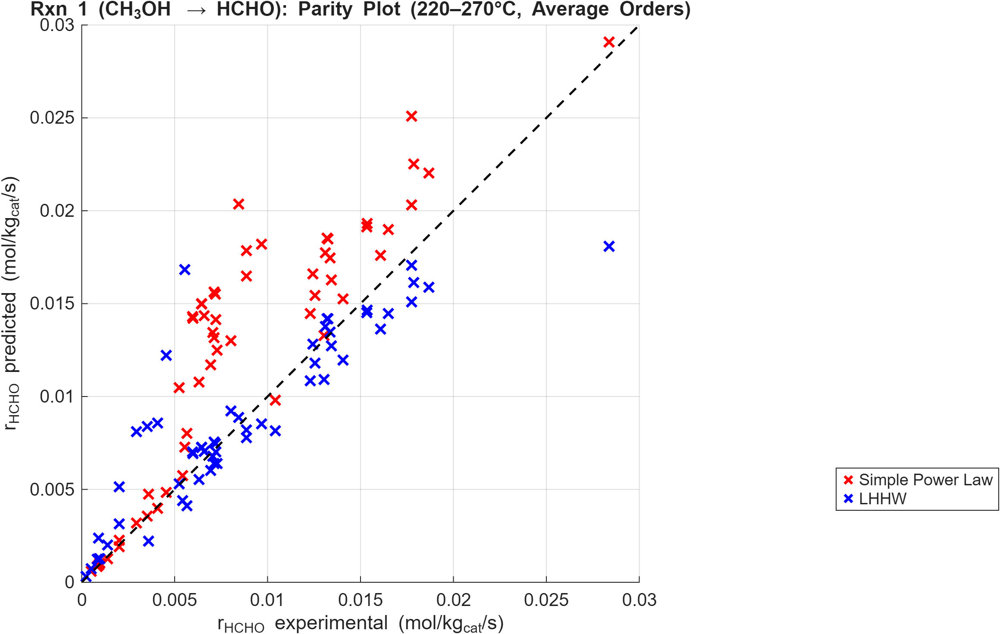
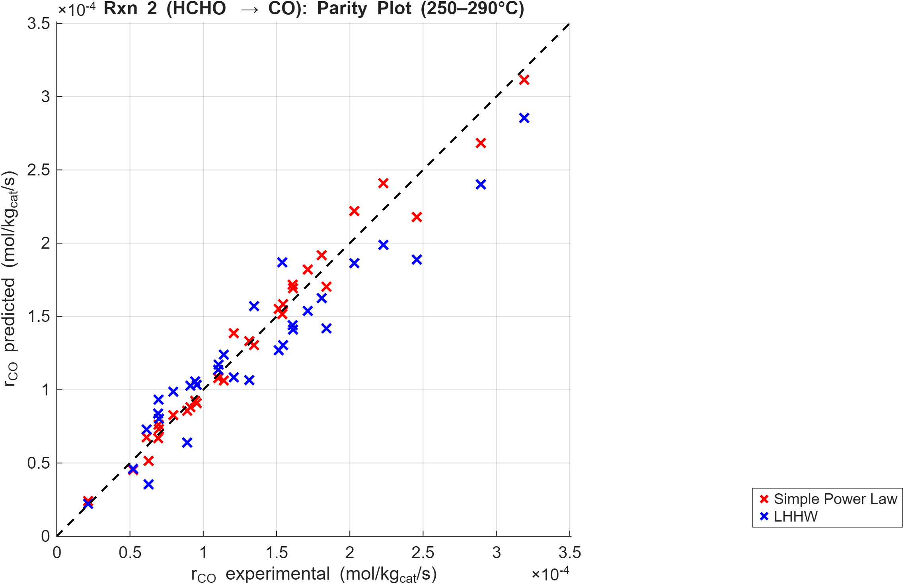
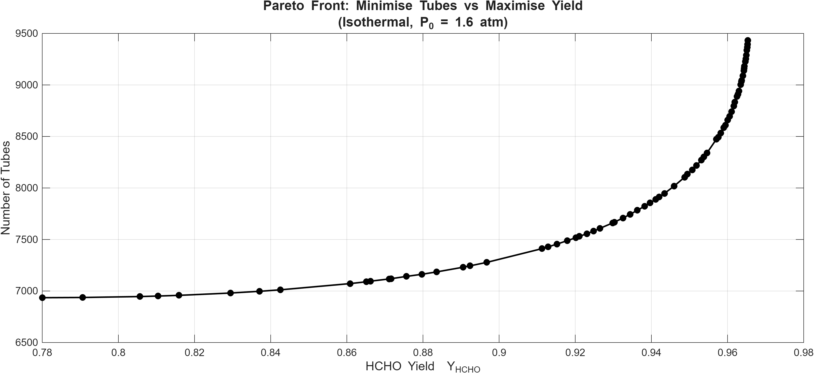
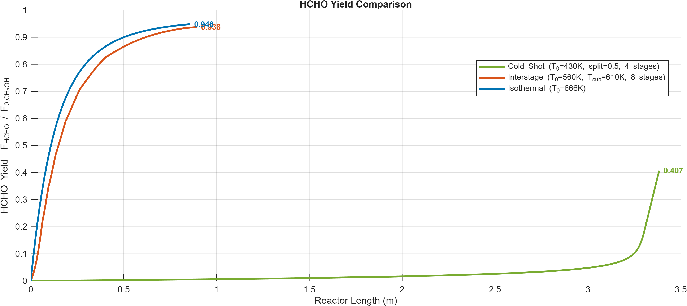
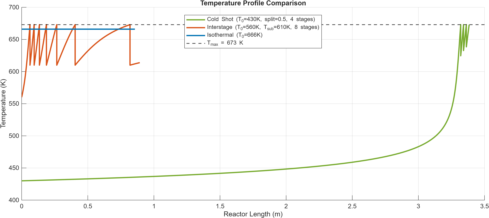

# Packed-Bed Reactor Modelling and Optimisation for Formaldehyde Production

**MATLAB | Reaction engineering · Heterogeneous catalysis · Reactor design · Multi-objective optimisation**

## Project overview

This university **group project** investigates the design of a multitubular catalytic packed-bed reactor for the partial oxidation of methanol to formaldehyde, targeting **100 tonnes of formaldehyde per day**. A one-dimensional reactor model was developed in MATLAB to investigate the competing effects of reaction kinetics, selectivity, pressure drop, temperature and cooling strategy on reactor performance.

The analysis progressed from fitting and comparing kinetic models to solving coupled reactor balances, sizing a nominally isothermal design, performing multi-objective optimisation and evaluating alternative cooling configurations. The numerical results below are **model predictions reported in the group project**, not plant operating data.

### Key results

| Metric | Selected isothermal design |
|---|---:|
| Formaldehyde production target | 100 tonnes/day |
| Reported formaldehyde yield | **94.8%** |
| Required parallel reactor tubes | **8,110** |
| Operating temperature | Approximately **670 K** |
| Estimated external cooling duty | **6.40 MW** |

The selected design balances high formaldehyde yield with the number of tubes needed to achieve the specified production rate. Because isothermal operation requires substantial heat removal, alternative cooling configurations were also examined.

## 1. Reaction system and kinetic model selection

The reactor includes two competing reactions:

**Desired partial oxidation**

$$
\mathrm{CH_3OH + \tfrac{1}{2}O_2 \rightarrow HCHO + H_2O}
$$

**Undesired further oxidation**

$$
\mathrm{HCHO + \tfrac{1}{2}O_2 \rightarrow CO + H_2O}
$$

Two rate formulations were investigated:

- **Power-law kinetics:** an empirical correlation fitted using experimental data extracted from the literature and project materials, including the inhibitory effect of water.
- **Langmuir–Hinshelwood–Hougen–Watson (LHHW) kinetics:** a surface-reaction-based formulation accounting for temperature-dependent kinetic and adsorption parameters, including water inhibition and oxygen adsorption.

The report's comparison against the extracted experimental reaction-rate data favoured the **LHHW model**. It was therefore used for the subsequent reactor design and operating-condition studies.

## 2. Packed-bed reactor model

A **steady-state, one-dimensional plug-flow model** represents a single catalyst-filled tube. For scale-up, all tubes are assumed to operate identically. The governing equations were implemented as coupled ordinary differential equations along the reactor length and integrated in MATLAB using **`ode45`**.

The model combines:

- **Molar balances:** the consumption and formation of methanol, oxygen, formaldehyde, water and carbon monoxide, based on the two reaction rates.
- **Pressure drop:** an Ergun-based packed-bed expression using the inertial contribution, with local gas density calculated under an ideal-gas assumption.
- **Energy balance:** a non-isothermal, adiabatic reactor formulation accounting for heat released by the exothermic reactions and temperature-dependent gas heat capacities.
- **Operating limits:** event functions that stop integration when specified temperature or pressure bounds are reached.

Isothermal cases are evaluated separately, with the required cooling duty calculated from the reaction heat release rather than by simulating an actual heat-transfer control system.

The calculations provide axial profiles of species molar flow, reaction rate, pressure, temperature, conversion and formaldehyde yield. The non-isothermal results illustrate how heat release can accelerate the reaction rate and create steep temperature rises, motivating the use of reactor cooling.

## 3. Reactor sizing and multi-objective optimisation

The selected isothermal reactor was sized for the **100-tonne/day** production target, using per-tube formaldehyde output to determine the number of tubes required in parallel.

A multi-objective genetic algorithm, **`gamultiobj` (NSGA-II)**, was used to explore two competing objectives:

1. **Maximise formaldehyde yield**.
2. **Minimise the required number of reactor tubes**.

Inlet temperature and per-tube mass flow rate were varied, subject to the simplified reactor model and its pressure constraint. The resulting **Pareto front** demonstrates that higher yield may require more parallel tubes. The project selected a compromise design with **94.8% reported yield and 8,110 tubes** at a temperature close to 670 K.

This is a **model-based design trade-off**, not a full capital- and operating-cost optimisation; tube cost, utility pricing and total equipment economics were not explicitly optimised together.

## 4. Sensitivity analysis

The project investigated the influence of operating and design parameters, typically varying them around nominal values:

| Parameter | Main finding reported |
|---|---|
| Inlet temperature | Strong influence on LHHW reaction rates and formaldehyde yield; higher temperature is not always beneficial |
| Oxygen composition | Increasing oxygen availability initially improves conversion/yield, but also supports the undesired oxidation route |
| Mass flow rate | Lower per-tube flow increases residence time and conversion, but affects the number of tubes required for the plant production target |
| Bed voidage | Moderate variations produced relatively small changes in the analysed yield profiles |
| Catalyst activity factor | Moderate changes affected performance less strongly than some operating parameters within the tested range |
| Tube diameter | Smaller diameter increases superficial velocity and pressure drop, limiting feasible reactor length |

These trends were used to identify parameters most relevant to operational performance and reactor sizing. They apply to the model assumptions and the ranges studied, rather than establishing universal sensitivities.

## 5. Comparison of cooling strategies

Three configurations were evaluated to explore the trade-off between formaldehyde yield and external cooling requirements.

| Reactor configuration | HCHO yield | External cooling duty | Required tubes | Stages |
|---|---:|---:|---:|---:|
| **Ideal isothermal reactor** | **94.8%** | **6.40 MW** | **8,110** | 1 |
| **Interstage cooling** | **93.8%** | **5.73 MW** | **8,200** | 8 |
| **Cold-shot cooling** | **40.7%** | **0 MW in the model** | **18,889** | 4 |

**Interstage cooling** reduced the estimated external cooling duty by approximately **10.5%** relative to the ideal isothermal case, while lowering yield by **1.0 percentage point** and requiring 90 additional tubes. It offered a closer performance match to the ideal isothermal design than cold-shot cooling.

**Cold-shot cooling** avoids an external cooler in the model by introducing additional cooler feed between stages, but the predicted yield fell to 40.7%, substantially increasing the tube requirement. A zero external cooler duty does **not** imply zero total energy demand.

For additional plots, see the full [figure gallery](figures/).

## 6. Model assumptions and limitations

This project is a preliminary reactor-design study. Key simplifications include:

- One-dimensional plug flow and identical behaviour across parallel tubes; radial and axial dispersion effects are not resolved.
- Ideal-gas behaviour, a single gas phase and a simplified two-reaction network.
- The inertial contribution to the Ergun pressure-drop relation, rather than the complete viscous-plus-inertial expression.
- Ideal isothermal operation for the selected reference design; the reported cooling duty is an estimated requirement, not a verified heat-exchanger design.
- Reactor performance evaluated through numerical simulations and literature-derived kinetics rather than pilot-plant measurements.
- A trade-off between yield and tube count without a complete techno-economic assessment.

These limitations mean the results should be interpreted as **preliminary model-based estimates**, not a construction-ready industrial design.

## 7. Running the MATLAB model

### Files

- **`RD_Group_11_MATLAB.m`** — main MATLAB script containing kinetic-model calculations, packed-bed reactor equations, sensitivity analysis, `gamultiobj` optimisation, cooling-strategy simulations and plot generation.
- **`figures/`** — exported figures (add the selected figures and, optionally, the full figure gallery).
- **`data extracted from Deshmukh.xlsx`** — source-data workbook used during the study; include it publicly only if redistribution is permitted.
- **Project report** — the original group report may be linked or included only if university and group-sharing permissions allow it.

### MATLAB requirements

The script uses core MATLAB functionality together with:

- **Statistics and Machine Learning Toolbox**, including `fitlm`.
- **Global Optimization Toolbox**, including `gamultiobj`.

### Run

1. Open MATLAB and set the Current Folder to the repository directory.
2. Open `RD_Group_11_MATLAB.m` and review the **USER INPUTS** section at the top (particularly the kinetic-model and cooling-configuration switches).
3. Run the script from the MATLAB Editor, or execute `RD_Group_11_MATLAB` in the Command Window.
4. Examine the generated plots and Command Window summaries.

**Important:** The present script's default settings are not a dedicated reproduction of the final selected LHHW design. Check the inputs before interpreting a run as reproducing a reported figure. The full script generates many figures, and the multi-objective optimisation may be computationally demanding.

## 8. Attribution and references

This work was completed as a **group project in Reaction Engineering at Imperial College London (2026)**. The report credits **Keo Chiu, Nikolas Chung, Seunghwan Roh, Théophile Vayson de Pradenne and Yejoo Lim**. Individual contributions should be stated separately where relevant; the overall project results are not claimed as the work of a single person.

The kinetic modelling uses literature-derived parameters and data, principally:

- **Deshmukh, S. A. R. K., van Sint Annaland, M., and Kuipers, J. A. M. (2005).** “Kinetics of the partial oxidation of methanol over a Fe–Mo catalyst.” *Applied Catalysis A: General*, **289**(2), 240–255.
- **Malik, M. I., Abatzoglou, N., and Achouri, I. E. (2021).** “Methanol to formaldehyde: An overview of surface studies and performance of an iron molybdate catalyst.” *Catalysts*, **11**(8), 893. https://doi.org/10.3390/catal11080893

The source report contains additional supporting references. No claim is made that the model has been experimentally validated independently of the cited data.
